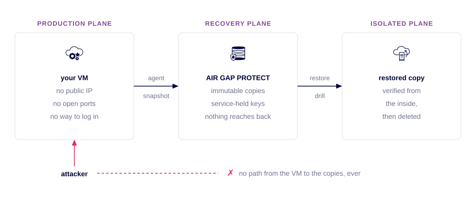
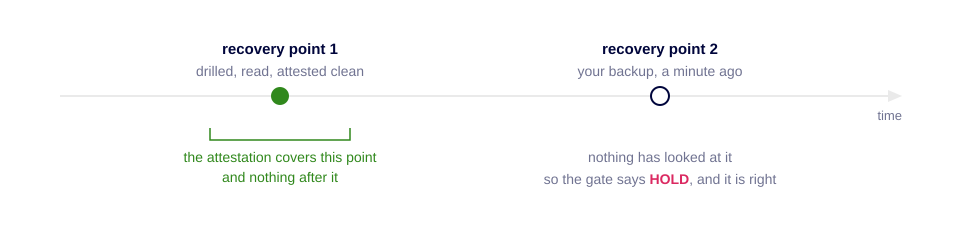
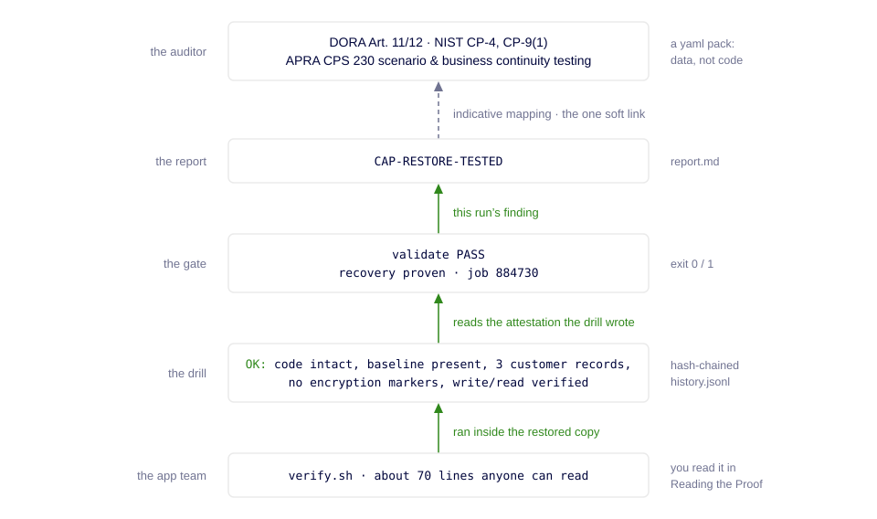
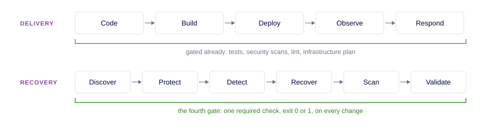

# DevOps Meets ResOps

> **A hands-on workshop in Resilience Operations:** proving recovery the way
> you already prove everything else: continuously, on evidence, and gated
> before it ships.

```hero
$ op gate infra/workloads
  ●●●●●●  VALIDATED
  PROMOTE  exit 0

$ op threatscan infra/workloads
  THREATS DETECTED

$ op gate infra/workloads
  ●●●●✗·  RECOVERABLE
  HOLD  exit 1
```

---

## About this workshop

Your delivery pipeline is versioned, automated and gated. Recovery usually is
not: it lives in a runbook and is tested once a year, if at all. Resilience
Operations (ResOps) is the discipline of running recovery the way you run
delivery, so that you can prove a critical service recovers, clean, on
demand.

```statement
You gate on tests.
You gate on security scans.
**You do not gate on recoverability.**
```

In this workshop you build a real service on Azure, protect it with Commvault
Cloud, compromise it on purpose, and prove its recovery with evidence. Then
you gate a pipeline on the result, the same way you already gate on tests.

## Who this is for

```list
 LEVEL            300-400.
 DURATION         About two hours, facilitated.
 WRITTEN FOR      Platform engineers, SREs and cloud architects who already
                  run CI, infrastructure as code and required checks, and
                  the people who fund that work.
 ASSUMES          You are comfortable with a terminal, a pull request and a
                  cloud console. No backup or recovery background is needed.
 YOU WILL LEAVE   Able to explain, and to demonstrate, why recoverability
                  belongs in the same place as your other required checks.
```

## What you will do

```list
 Building the Workload        You build a service, protect it, and prove
                              once that it recovers.
 Reading the Proof            You read what a passing result looks like
                              and where each of its claims comes from.
 Introducing a Compromise     You see that a green job status is not a
                              verdict about your data.
 Choosing a Recovery Point    You learn why, under compromise, the freshest
                              recovery point is the most dangerous one.
 Re-Proving Recovery          You earn the verdict back by checking a new
                              recovery point.
 Gating the Pipeline          You add recoverability as a fourth required
                              check, built like the other three.
 Cleaning Up                  You remove everything you built and verify
                              that it is gone.
```

Most chapters run against your own Azure VM and Commvault Cloud. Chapters 4
and 6 also run offline examples that need no cloud account.

This page works with the network off. The expected results in each box come
from real runs, so job ids, times and names will differ on your screen. If
anything else does not match a box, follow the box's instructions, and tell
your facilitator if it still does not match.

## Setup

Setup takes about ten minutes.

**What you need.** The environment is built for you, so you need very little.

```list
 a Codespace                Your own resops-lab Codespace, fully built.
                            `op`, `resops`, `az` and `terraform` are already
                            on your PATH, and Grafana, Prometheus and a
                            pushgateway are already running beside it.
 seven values               Three Azure credentials, two Commvault Cloud
                            tokens, your codename and your resource group,
                            all from your facilitator's credentials file.

                            The Azure credential can reach only your own
                            resource group, which is why several checks
                            report **skipped** rather than failing. The
                            Commvault token pair is yours alone: each
                            renewal replaces it, so a pair that is shared or
                            pasted into a second Codespace stops working.
 nothing else               You do not clone, install or edit anything else.
                            `config/workshop.yaml` is shared and already
                            filled in.
```

**This lab creates real Azure resources, and they bill until you remove them
in Chapter 7, Cleaning Up.** Do not skip that chapter.

### How to read the commands on this page

Every numbered step is one of two things. Everything that is not a
numbered step is explanation: read it, but there is nothing to run.

```list
 ▶ Run in your terminal   A command. Click the block to copy it, paste it into
                          the terminal, and press Enter. The `$` is the prompt
                          and is not copied.
 ✎ Do this                An action outside the terminal, such as editing a
                          file or clicking in a web console.
 ✓ You should see         What the command prints, so you can compare. Text in
                          the dashed box tagged **output, do not type** is the
                          machine's answer. Never paste it back in.
 ✗ If not                 What to do when the output does not match.
 ⏱ How long               How long it takes, and what happens while you wait.
 angle brackets           A placeholder for your own name, such as
                          `<your-codename>`. It appears in output, never in a
                          command, so every command is the same for everyone.
```

Two rules hold for every command in this workshop:

```list card
 where to run   Run every command from the repository root,
                `/workspaces/resops-lab`. A new terminal starts there.
                If you have used `cd`, run `cd /workspaces/resops-lab`
                first.
 op commands    Every `op` command ends with `infra/workloads`, the folder
                that holds your Terraform. Without it, `op` prints a usage
                line and does nothing.
```

### Prove your machine is ready

```bash
which op resops
```

```
 ✓ YOU SHOULD SEE   The terminal prints two paths, both inside your Codespace.
                    /workspaces/resops-lab/bin/op
                    /workspaces/resops-lab/bin/resops
 ✗ IF NOT           If it prints `op: command not found`, `bin/` is not on your PATH, usually because setup did not finish. Run `bash .devcontainer/postCreate.sh`, then open a new terminal and try again. In a room, ask now rather than when the first command runs.
```

### Create your .env

```bash
mv .env.example .env
```

```
 ✓ YOU SHOULD SEE   The command prints nothing when it works.
```

```do
1. Open `.env` in the editor.
2. Copy your seven values into it from the credentials file your
   facilitator gave you. Keep the quotes around `ARM_CLIENT_SECRET`.
3. Save the file.
```

```
 ✓ YOU SHOULD SEE   Every line in `.env` has a value after the `=`, and the secret is still inside its quotes. Your codename is two lowercase words joined by a dash, such as `brave-otter`, and your resource group ends with it.
                    ARM_CLIENT_ID=<...>
                    ARM_CLIENT_SECRET="<...>"
                    ARM_TENANT_ID=<...>
                    CV_ACCESS_TOKEN=<...>
                    CV_REFRESH_TOKEN=<...>
                    TF_VAR_codename=<your-codename>
                    TF_VAR_resource_group=rg-resops-u<n>-<your-codename>
```

### Load your credentials

Terraform reads `.env` only through the shell, so the terminal has to re-read
the file after every edit. Open a new terminal, which loads `.env`
automatically, or run the command below. `op` reads `.env` directly and does
not need this step.

```bash
set -a; . ./.env; set +a
```

```
 ✓ YOU SHOULD SEE   The command prints nothing when it works.
 ✗ IF NOT           If it prints `No such file or directory`, you are not in the repository root, or `.env` does not exist. Run `cd /workspaces/resops-lab`, then `ls .env`. Run this command again, or open a new terminal, after any edit to `.env`.
```

### Sign in to Azure

The `az` CLI does not read `.env`, so sign it in with the values you just
loaded. Copy the whole command; it is one line.

```bash
az login --service-principal -u "$ARM_CLIENT_ID" -p "$ARM_CLIENT_SECRET" --tenant "$ARM_TENANT_ID" -o none
```

```
 ✓ YOU SHOULD SEE   The command prints nothing when the sign-in works.
 ⏱ HOW LONG         A few seconds
 ✗ IF NOT           `AADSTS7000215` (invalid client secret) means the secret in `.env` is wrong, or lost its quotes. `AADSTS700016` (application not found) means `ARM_CLIENT_ID` or `ARM_TENANT_ID` is wrong. If it says a value is missing or empty, this terminal has not loaded `.env`: run `set -a; . ./.env; set +a`, then sign in again.
```

### Check what you filled in

`op validate` reads your `.env` and the shared config, and checks that every
value is present and that Azure accepts your sign-in.

```bash
op validate infra/workloads
```

```
 ✓ YOU SHOULD SEE   A list of PASS lines, ending with `validate PASS — safe to climb and teardown`.
                    PASS  config/workshop.yaml and .env — no placeholder
                          values
                    PASS  az logged in, correct subscription
                    PASS  terraform not yet applied in infra/workloads —
                          workload checks skipped
                    validate PASS — safe to climb and teardown
 ✓ THIS IS EXPECTED  Two PASS lines say skipped. The IAM check is skipped because your credential cannot read at subscription level. The workload checks are skipped because you have not run `terraform apply` yet. Skipped is not a failure, and there is nothing to fix.
 ⏱ HOW LONG         About ten seconds
 ✗ IF NOT           Read the FAIL line, because it names the problem. `FAIL  2 unfilled field(s): TF_VAR_codename in .env, TF_VAR_resource_group in .env` means those lines in `.env` are empty: fill them in, save the file, and run `op validate infra/workloads` again. `az not logged in` means the sign-in step did not work, so run it again. `Commvault token is dead` means your token pair no longer works: follow **Create a new Commvault token pair** below.
```

Check that your codename and resource group match your credentials file
exactly. The codename names your VM, your Commvault VM group and your
evidence files for the rest of the workshop.

### Open the wall

The Grafana dashboard, called the wall in this guide, shows every workload at
once. Open it now so that you see the starting state.

```do
1. In your Codespace, open the **Ports** tab, then open port 3000. Its label
   names Grafana and the ResOps dashboard.
2. Sign in with the username `admin` and the password `resops`.
3. Open the **ResOps** folder, then the **DevOps Meets ResOps** dashboard.
```

```
 ✓ ON THE WALL      The wall shows six sample services and three numbers: how many cannot prove recovery, how long a clean recovery takes, and how often a check found something. The samples were loaded when your Codespace was built, so none of this is yours yet.
                    Cannot prove recovery                 5 of 6
                    Mean Time to Clean Recovery (MTCR)    3 hr
                    Checks that found a problem           1 of 3
 ✗ IF NOT           An empty dashboard means the sample data was not loaded. Run `bash .devcontainer/postCreate.sh` to load it again. If the sign-in page keeps returning, the browser cached an old session: open the port in a private window.
```

Below the numbers is one band per service. At the default 90-day view, every
band is a thin strip at the right edge, so set the time picker to Last 3
hours to see them properly.

Leave this tab open. Every command that changes your workload updates the
wall when it finishes, and this guide tells you when to look.

### When something fails

Search this page for the text your terminal printed. The left column is the
error, verbatim. The first eight rows are about the terminal rather than the
lab, and they cause most problems.

```list
 op: command not found         `bin/` is not on your PATH. Run
                               `bash .devcontainer/postCreate.sh`, then open
                               a new terminal.
 usage: op                     The command is missing `infra/workloads`. Every
                               `op` command must end with it, for example
                               `op validate infra/workloads`.
 not yet applied               `op validate` prints `terraform not yet
                               applied in infra/workloads` as a PASS line.
                               Before your first `terraform apply`, that is
                               expected. After the apply, it means you are
                               not in the repository root. Run
                               `cd /workspaces/resops-lab` and try again.
 terraform init                Terraform asks you to run init, or reports
                               missing plugins or an inconsistent lock file.
                               Run `terraform -chdir=infra/workloads init
                               -input=false` from the repository root. Running
                               `terraform init` in the root does not work,
                               because the Terraform files are in
                               `infra/workloads`.
 Please run 'az login'         Terraform cannot see your `ARM_*` values,
                               because this terminal has not loaded `.env`
                               since you edited it. Open a new terminal, or
                               run `set -a; . ./.env; set +a`.
 No codename                   Terraform cannot see `TF_VAR_codename` and
                               `TF_VAR_resource_group`. Check that both are
                               filled in `.env`, then open a new terminal or
                               run `set -a; . ./.env; set +a`, and run the
                               apply again.
 az not logged in              Run the command in Sign in to Azure again. A secret
                               pasted without its quotes is the usual cause.
 CV_ACCESS_TOKEN not set       `.env` is missing or was not saved. Run
                               `ls .env` from the repository root.
 missing                       `missing …/config/workshop.yaml` means you are
                               not in the lab folder. Run
                               `cd /workspaces/resops-lab` and try again. If
                               the file was deleted, it is tracked in git, so
                               `git checkout config/workshop.yaml` restores
                               it. There is nothing to fill in.
 no `workload` output          `terraform apply` has not run, or ran in a
                               different directory. Run it from the repository
                               root.
 not in /VM                    Discovery has not run since your VM was
                               created. Ask your facilitator to run it again.
                               Then check that your VM is listed in Command
                               Center under Protect, Cloud discovery, Azure,
                               Resources.
 no vmgroup for                `op protect` has not run for this workload yet.
                               Run `op protect infra/workloads`.
 could not run the command     The VM is not running, or its guest agent is
                               not ready. The agent needs about two minutes
                               after boot. Retry once before investigating.
 Waiting                       The job is queued for a media agent, the
                               worker that moves backup data. This usually
                               takes a few minutes and occasionally much
                               longer. Do not stop the command.
 lost contact with Commvault   Six reads of a job's status failed in a row.
                               The job may still be running. Check the job id
                               in Command Center before you run the command
                               again, or a second job starts. A few
                               `read failed, retrying` lines on their own are
                               normal: the command keeps going.
 could not reach Commvault     A network error. Check the Codespace is online,
                               then run the command again. `did not answer
                               within 120s` is the same advice.
 RESOPS_DEBUG=1                Any other error ends by suggesting this. Run
                               the command again with `RESOPS_DEBUG=1` in
                               front of it and show the output to your
                               facilitator.
 No suitable access node       A threat scan found no free scanning worker.
                               Nothing is wrong with your workload: run the
                               scan once more. If it fails the same way, tell
                               your facilitator.
 Commvault token is dead       Your Commvault token pair no longer works.
                               The same problem can print as `Auth failed:
                               Renewal returned HTTP 4xx`, sometimes with
                               `invalid/expired` in the reason, and nothing
                               publishes to the wall until you fix it. Create
                               a new pair: see **Create a new Commvault token
                               pair** below.
 threatscan trigger refused    The scan plan id is missing or wrong. It is
                               `scan_plan_id` in the shared
                               `config/workshop.yaml`, so do not edit it. Tell
                               your facilitator.
 no run to publish             No gate has run yet for this config.
                               `resops metrics` publishes the last gate run
                               rather than running its own, so run the gate
                               first, for example
                               `resops gate config/estate.yaml`.
 does not cover the newest     Something backed up after your last drill, so
                               the proof no longer covers the newest recovery
                               point. Run the drill again. A scheduled backup
                               can cause this with nobody running anything.
 older recovery point dirty    The last drill found an earlier recovery point
                               dirty, and nothing has checked the newest one.
                               Run the drill: it shows whether the repair
                               reached the backup.
```

**Before you investigate anything, run these three commands.** All three are
read-only. `op validate` and `op preflight` work even when your Commvault
token is dead and tell you so; `op status` needs a working token.

```
 op validate infra/workloads     Does your config parse, and are the ids present?
 op preflight infra/workloads    Can this machine reach Azure and the tenant?
 op status infra/workloads       What does the platform believe about your workload?
```

### Create a new Commvault token pair

Do this only when a command reports that your Commvault token is dead, or
prints `Auth failed`. A token pair stops working when it expires, or when
the same pair is used in two places, because each renewal replaces it.

```do
1. Sign in to Command Center.
2. Open **Manage**, then **Account**, then **Access tokens**.
3. Click **Add token**. Leave every setting at its default, and click
   **Create token**.
4. Copy the access token and the refresh token it shows.
5. In `.env`, replace the values of `CV_ACCESS_TOKEN` and `CV_REFRESH_TOKEN`
   with the new ones, and save the file.
```

```
 ✓ YOU SHOULD SEE   `op preflight infra/workloads` (or `op validate infra/workloads` during Setup) reports PASS for the Commvault token. `op` reads `.env` directly, so you do not need to reload it.
 ✗ IF NOT           If you cannot see **Access tokens**, or the new pair fails too, tell your facilitator. Do not reuse a pair from anyone else.
```

### Three questions, before anything runs

Write down your answers now, and compare them with what you know at the end
of the workshop.

```list
 1   What percentage of your production estate could you PROVE is
     recoverable right now? Proven means something opened a copy and
     read it, not that a backup job ran.
 2   Who would you have to convince, and what would they accept as proof?
 3   How long would producing that proof take, starting now?
```

---

## Chapter 1 · Building the Workload

```
 STAGE      All six. Discover, Protect, Detect, Recover, Scan, Validate: the
            full climb, once, so you have seen what a yes is made of.
 EXERCISE   Stand up a production service, protect it, and climb it to a
            proven recovery
 LEARN      The three planes, the only way into a sealed VM, and what a
            drill actually opens
 RULE       Recovery is demonstrated or it is assumed. There is no third
            state.
 NEXT       Pick one workload you own and find out whether the platform has
            even discovered it. This is read-only, and you can do it today.
 DONE WHEN  `op gate infra/workloads` says PROMOTE and exits 0. That is
            recovery demonstrated rather than assumed. If it says HOLD and
            names Scan, the drill has not run, so run `op restore
            infra/workloads` first.
```

This chapter builds three environments and moves a workload through all of
them.



Every verdict in this workshop is read from a copy rather than from the
machine that produced it, because a compromised machine can only report on
itself.

```list
@cloud-server PRODUCTION PLANE   An Azure VM, built by Terraform, that runs a
                    small service. It has no public IP and no inbound
                    rules. Commands reach it only through the Azure guest
                    agent, a process inside the VM that runs scripts Azure
                    sends to it.
@secure-storage RECOVERY PLANE   Commvault Cloud protects that VM into an
                    immutable copy held in its own security domain, with
                    credentials the VM never has.
@ransomware DETECTION            A scan opens a recovery point in the
                    recovery plane and reads it there, without touching
                    production.
@vm-restore ISOLATED PLANE       An out-of-place restore builds a new VM from
                    one recovery point, verifies it from the inside, and then
                    deletes it.
@command-center THE CONSOLE      Command Center, the Commvault Cloud web
                    console. You use it to confirm discovery and to see
                    the threat view. Every other operation is an API call.
```

### Provision the service

Initialize Terraform first. Your Codespace tries to do this when it is built,
but it does not always succeed, and running it again is safe.

```bash
terraform -chdir=infra/workloads init -input=false
```

```
 ✓ YOU SHOULD SEE   Terraform downloads its providers and ends with a success message.
                    Terraform has been successfully initialized!
 ⏱ HOW LONG         Under a minute
 ✗ IF NOT           If it prints `chdir infra/workloads: no such file or directory`, you are not in the repository root: run `cd /workspaces/resops-lab` and try again. A network or download error is usually temporary, so run the command once more.
```

Now create your VM and its network.

```bash
terraform -chdir=infra/workloads apply -auto-approve
```

```
 ✓ YOU SHOULD SEE   Terraform reports `Apply complete!` and prints one output, `workload`, with eight values. Every later command reads these values instead of working out names for itself.
                    Apply complete!
                    Outputs:
                    workload = {
                      "location" = "eastus2"
                      "resource_group" = "rg-resops-u<n>-<your-codename>"
                      "restore_storage_account" = "<yourcodename>rst<...>"
                      "subnet_id" = "/subscriptions/<...>"
                      "vm_guid" = "<...>"
                      "vm_name" = "<your-codename>"
                      "vm_size" = "Standard_F1als_v7"
                      "vnet_name" = "resops-<your-codename>-vnet"
                    }
 ⏱ HOW LONG         About two minutes
 ✗ IF NOT           Read the first error line. If Terraform says to run `terraform init`, or reports missing providers or an inconsistent lock file, run the init step above again, then the apply. `No codename or resource group` means this terminal has not loaded `.env`: run `set -a; . ./.env; set +a`, then the apply. For a quota or login error, run `az account show` to check the sign-in, then run the apply once more.
```

### Connect the platform

The platform has to discover a new cloud resource before it can protect it.
**Your facilitator runs discovery for the room** once everyone's
`terraform apply` has finished. Your part is to confirm that your VM appears
in Command Center.

```do
1. Sign in to Command Center.
2. Open **Protect**, then the **Cloud discovery** tab.
3. Open **Azure**.
4. Open the **Resources** tab.
```

```
 ✓ YOU SHOULD SEE   Your VM is listed, along with the storage account and table storage that your apply created.
                    <your-codename>              Azure VM                 eastus2
                    <yourcodename>rst<...>       Azure storage account    eastus2
                    <yourcodename>rst<...>       Azure Table storage      eastus2
 ⏱ HOW LONG         About two minutes after your facilitator starts discovery.
                    The page does not refresh on its own, so reload it to see
                    new resources.
 ✗ IF NOT           If your VM is missing, discovery has not run since your
                    `terraform apply` finished. Tell your facilitator, wait
                    for them to run it again, then refresh the Resources tab.
```

```
 ? HOW IT WORKS: WHY THREE RESOURCES
   Your apply created a VM and a storage account for restore staging,
   and the console lists the account's table storage separately. Only
   the VM is your workload. Discovery makes it visible; `op protect`
   protects it.
```

The next command asks the API to confirm what you just checked in the
console.

```bash
op preflight infra/workloads
```

```
 ✓ YOU SHOULD SEE   Five PASS lines, ending with `preflight PASS — safe to climb`. The most important one says the platform has discovered your workload.
                      PASS  <your-codename> discovered (cloud-native inventory)
                    preflight PASS — safe to climb
 ✗ IF NOT           Each FAIL line names its own fix. If a line says `not discovered` even though your VM is in the Resources tab, the console and the API disagree. Tell your facilitator; do not try to run discovery yourself.
```

### The first recovery point

```bash
op protect infra/workloads
```

```
 ✓ YOU SHOULD SEE   The command creates a VM group and adds your VM to it. A VM group is a named set of machines that share one protection plan, and every later command uses its id.
                    protected: group 12345  (<your-codename> by <vm-guid>,
                    IntelliSnap off)
 ✗ IF NOT           A failure that mentions discovery means the platform cannot see your VM yet. Ask your facilitator to run discovery again, confirm your VM in the Resources tab, then re-run this.
```

```bash
op backup infra/workloads
```

```
 ✓ YOU SHOULD SEE   The command prints the backup job id and its VM group, then waits until the job reports `Completed`.
                    backup job 8210418 on group 12345…
                    backup Completed
 ⏱ HOW LONG         About two minutes
 ✗ IF NOT           If it sits on "Waiting", the job is queued for a media agent, the worker that moves backup data. That is normal and not a failure. Do not stop the command. If it stops with `lost contact with Commvault`, check the job in Command Center before you run the command again, so that you do not start a second backup.
```

```
 ? HOW IT WORKS: AIR GAP PROTECT
   The recovery point landed in Air Gap Protect, an immutable storage
   pool in a separate security domain. Its credentials belong to the
   backup service, never to the VM, so malware on the machine has no
   path to the copies. Retention locking means nobody can alter or
   delete them during the retention window.
```

### Check it for threats

Threat Scan opens the recovery point in the recovery plane and looks for
malware there, without touching the VM.

```bash
op threatscan infra/workloads
```

```
 ✓ YOU SHOULD SEE   The command starts a scan job, shows its progress, and prints a verdict. On a clean workload the verdict says no threats were found, and also says what that does not prove.
                    threatscan job <n>  (client <n>, scan plan <n>)...
                    threatscan attempt Completed
                    verdict: no threats found. A scan cannot prove a recovery
                    point is clean; the restore drill checks that.
 ⏱ HOW LONG         About three minutes, sometimes up to nine. The job waits
                    for a scanning worker first; the progress line keeps
                    moving while it does.
 ✗ IF NOT           `Commvault: No suitable access node found` means no scanning worker was free. Run the scan once more. If it stops and names `scan_plan_id`, tell your facilitator, because that value is in the shared `config/workshop.yaml`.
```

The scan goes first so that a recovery point that is already flagged is never
restored. It cannot prove the point is clean, because a scan reports only
what it matched. Only the restore drill opens the copy and checks it from the
inside.

Backup, scan, drill and gate are the loop the rest of the workshop repeats:
here on a clean workload, in Chapter 3 on a compromised one, and in Chapter
5 after the repair.

### Prove it restores

The restore drill builds a new VM from the recovery point, runs a check
inside it, and then deletes it. Production is never touched.

```bash
op restore infra/workloads
```

```
 ✓ YOU SHOULD SEE   The command runs its pre-flight checks, the restore job completes, the restored VM is checked in Azure, and the command prints a verdict block. The `attestation` line is the result. The lines under it show what the check found inside the copy and where the result was saved.
                    Pre-flight: leftover restored VM
                      none
                    ...
                    === DRILL VERDICT ===
                      job status : Completed
                      azure VM   : PASS — exists & running
                      attestation: PASS — attested clean
                                   code intact, baseline present,
                                   3 customer records, no encryption
                                   markers, write/read verified
                                   → evidence/attestations/<your-codename>.json
 ✓ THEN IT WAITS    The drill pauses and asks you to press Enter before it deletes the restored copy. It is not stuck: the copy is running in Azure, and this is the only time it exists. Press Enter when you are ready. If you press Ctrl-C instead, the drill still deletes the copy so that it does not keep billing.
                    ✓ RECOVERED: <your-codename>-restore is running in
                      Azure (RG rg-resops-u<n>-<your-codename>).
                    Press Enter to tear it down…
 ⏱ HOW LONG         About three minutes to the verdict, then it waits for you. The teardown after Enter is about a minute.
 ✗ IF NOT           A failure saying the guest agent is not ready is temporary on a fresh restore, so run the command again. A `FAIL:` line means the check inside the copy found a problem: read it before you retry.
```

### Your row on the wall

Return to the Grafana tab and wait for it to refresh.

```
 ✓ ON THE WALL      The headline now counts your workload: its total goes from 6 to 7. Find your codename in the table **Every service, furthest from proven first**. Proven workloads sort last, so yours is at the bottom, next to payments-api. Scroll inside the table if you cannot see it.
                    Cannot prove recovery          5 of 7
                    <your-codename>   VALIDATED    proven just now
 ✗ IF NOT           The page refreshes every ten seconds, so wait for one refresh. If the total still reads 6, your workload did not publish, and your terminal says why. `Auth failed: …` means your Commvault token is dead: follow **Create a new Commvault token pair** in Setup. Any other failure prints `(dashboard not updated: …)` with the reason, and it never stops the command it was attached to.
```

You did not publish your row by hand. Every `op` command that changes your
workload updates the wall when it finishes. The last two lines of each
command show the link: `dashboard` says what the wall now shows, and `next`
names the command that would change it.

```
 ✦ WHAT YOU JUST BUILT
   You built a sealed production service, a recovery point it cannot
   touch, and a drill that proved the point restores clean. Your row on
   the wall says so, published by the work itself.
```

## Chapter 2 · Reading the Proof

```
 STAGE      None. This chapter reads the ladder instead of moving it, and
            it is the only one that can afford to.
 EXERCISE   Read the ladder, the gate, and the contract that earned them
 LEARN      What a Service Resilience Indicator is, and what an
            attestation actually claims
 RULE       A gate whose pass is not routine cannot make its fail
            meaningful.
 NEXT       Open the bar your workloads are judged against. If it does not
            state a number somebody tests, you have found your first gap.
            This is read-only, and you can do it today.
 DONE WHEN  you can point at the line in `op gate` that is the evidence,
            and say where its job id came from. Every command in this
            chapter only reads; none of them changes your workload.
```

Your workload is at the top of its ladder. This chapter shows where each part
of that result comes from.

### Read the ladder

```bash
op status infra/workloads
```

```
 ✓ YOU SHOULD SEE   The command prints six dots and your state, then draws the ladder with a marker on your current rung. Below it, one line per stage names the fact that cleared that stage and the delivery practice it maps to. The discover line names your own group.
                    <your-codename>   workshop  resops-team

                    ●●●●●●  VALIDATED  ·  RPO 0.1h
                    ✓ recovery proven — job 8210533

                     █━━━━━━━━━█  ● Validate  VALIDATED  ← you are here
                     █         █
                     █━━━━━━━━━█  ● Scan      TRUSTED
                       ...
                     ═══════════  UNDISCOVERED

                        ✓ discover  onboarded — in
                                    'resops-<your-codename>-<id>-vg'
                            ↳ like service discovery — is the workload
                              onboarded?
                    evidence   evidence/<your-codename>/bundle.json
                    dashboard  2 of 7 provable across the estate
                    next       op gate infra/workloads
 ✗ IF NOT           Repeat the Chapter 1 steps that built this workload. In a room, tell the facilitator your codename rather than debugging it yourself.
```

Each stage pairs a recovery fact with a practice you already run:

```list
 discover    Service discovery. Is the workload in a VM group?
 protect     Drift detection. Does declared coverage match actual?
 detect      A health check. Did the last backup complete cleanly?
 recover     Rollback readiness. Is the recovery point recent enough?
 scan        Artifact scanning. Has anything read the copy?
 validate    A restore drill. Has recovery been demonstrated?
```

Clearing each of the six stages moves the workload up one of seven states:

```
 UNDISCOVERED ─▸ DISCOVERED ─▸ PROTECTED ─▸ MONITORED ─▸ RECOVERABLE ─▸ TRUSTED ─▸ VALIDATED
      0              1             2            3             4            5           6
      │              │             │            │             │            │           │
   nothing         in a        a plan is   backups are    a recent      a drill   the restore
  knows it       VM group      attached    completing    enough copy   found it     job is
   exists                                                  exists        clean     confirmed
```

Only VALIDATED is a claim about recovery. The other states describe the
machinery around it, which is why an estate can look green on a backup
dashboard and still fall short here.

### The bar it passed

```bash
op gate infra/workloads
```

```
 ✓ YOU SHOULD SEE   The command prints your codename, the ladder, the evidence line and the trend, then the verdict and its exit code.
                    <your-codename>
                    ●●●●●●  VALIDATED  ·  RPO 0.1h
                    ✓ recovery proven — job 8210533
                    = held at VALIDATED over 3 runs

                    PROMOTE  exit 0
 ✗ IF NOT           If it says HOLD and names coverage, a backup ran after your last drill, possibly a scheduled one (see below). Run the drill again and re-gate, or keep reading: you meet that exact behavior on purpose in the next chapter.
```

```
 ? HOW IT WORKS: A BACKUP NOBODY RAN
   A protection plan can also back up on a schedule. A scheduled backup
   creates a recovery point that nothing has checked, so your workload
   drops to RECOVERABLE and the gate says HOLD. That is correct, and a
   drill on the new point restores the verdict.
```

Three lines in that output appear on every run from here:

```
 = held at VALIDATED over 3 runs
       the trend, read from this workload's own history.

 ✓ recovery proven — job 8210533
       the evidence: the job that opened that recovery point and read it.

 PROMOTE  exit 0
       the verdict, and the exit code a pipeline reads.
```

The bar is set per tier rather than as a single threshold:

```bash
cat config/tiers.yaml
```

```
 ✓ YOU SHOULD SEE   The file defines two tiers, each with three numbers: how much data loss it tolerates, how long recovery may take, and how recently something must have verified a recovery point
                    rpo_hours
                    rto_minutes
                    attestation_max_age_days
```

A measurable target like this, per service tier, is a Service Resilience
Indicator. It plays the same role for recovery that a service level objective
plays for reliability.

### The contract that earned it

The verdict came from this script, which the drill runs inside the restored
copy through the guest agent:

```bash
grep -A 80 'path: /opt/app/verify.sh' infra/modules/azure-vm/cloud-init.yaml
```

```
 ✓ YOU SHOULD SEE   About 70 lines of shell script that run five checks. The last one WRITES a record and reads it back, and the script ends at exit 0. The start of the next file in the listing may show below that.
```

Four of the five checks ask whether the right data is there. The fifth asks
whether the store still accepts writes, because a read-only disk passes the
first four and fails a real service on its first write.

The drill saves the script's verdict in an attestation file: which recovery
point, what was checked, and when. The gate reads that file, so the verdict
is evidence rather than a flag somebody set.

```
 ✦ WHAT YOU JUST READ
   You read a proven ladder, a per-tier bar, and a short contract owned
   by the people who know what "good" means for this service. Every
   claim traces to something you can open and read.
```

## Chapter 3 · Introducing a Compromise

```
 STAGE      Scan. It falls, and it falls from a backup job that said
            Completed.
 EXERCISE   Compromise the workload you built, run the loop again, and
            watch two controls catch it two different ways
 LEARN      Why proof does not accumulate, and where a verdict can
            honestly come from
 RULE       Green is a job status, not a verdict about your data.
 NEXT       Take one existing backup of one workload and have something
            open it and read it. Do it this week. You are not changing
            anything; you are finding out whether anything ever has.
 DONE WHEN  `op gate infra/workloads` says HOLD and exits 1. HOLD is the
            correct answer in this chapter. If you got PROMOTE the
            incident did not land: run `op incident`, then the loop again
            (`op backup`, `op threatscan`, `op restore`, `op gate`).
```

Now you break the workload on purpose, with something harmless and
detectable, and run the same loop again.

### Write it down before we break it

Answer this before you run anything in this chapter. Chapter 4 asks the same
question after the tools have answered it.

```
  If ─────────────────────── happens to my workload,
       (a specific failure)

  I would recover from ─────────────────── ,
                        (which recovery point)

  and I would know it worked because ─────────────────── .
                                       (what you would check)
```

### Plant the compromise

```bash
op incident infra/workloads
```

```
 ✓ YOU SHOULD SEE   The command says what it is about to plant, then what it planted, then confirms that the known-good marker is still there.
                    incident: planting a detectable compromise in
                    <your-codename> (rg-resops-u<n>-<your-codename>)
                      EICAR test pattern + high-entropy .locked files —
                      inert, no real encryption
                    planted: 2 EICAR files, 14 .locked files, 1 note
                    BASELINE marker still present: yes

                    Compromise planted. The ladder cannot see it until a
                    backup captures it.
 ✓ THIS IS EXPECTED  This command plants a compromise on purpose. The files are inert test patterns, not malware. Do not clean them up: the next steps depend on them.
 ⏱ HOW LONG         Up to a couple of minutes, with no output until it is
                    done. The VM has no inbound access, so this runs through
                    the Azure guest agent, which is a single blocking call
                    that reports once at the end rather than streaming.
 ✗ IF NOT           Check that the VM is running, because the guest agent needs about two minutes after boot. Retry once. If it fails again, stop and ask your facilitator.
```

EICAR is a standard test string that every malware scanner detects, so
detection can be tested safely. The `.locked` files are random data named the
way ransomware names encrypted files. Nothing here encrypts or damages
anything.

### Commit it into a recovery point

```bash
op backup infra/workloads
```

```
 ✓ YOU SHOULD SEE   The backup completes as it did the first time, with a new job id.
                    backup job <n> on group <n>…
                    backup Completed
 ✓ THIS IS EXPECTED  Your band on the wall falls two rungs even though the backup succeeded. That drop is the point of this step, not an error.
 ✓ ON THE WALL      Your band steps down two rungs, from VALIDATED to RECOVERABLE. A job that succeeded moved you backwards, because it made a recovery point nothing has verified.
 ⏱ HOW LONG         About two minutes
 ✗ IF NOT           If it sits on "Waiting", the job is queued for a media agent, the worker that moves backup data. That is normal and not a failure. Do not stop the command.
```

### Proof does not carry over

Check why the ladder fell. This command only reads.

```bash
op status infra/workloads
```

```
 ✓ YOU SHOULD SEE   The ladder is two rungs lower and stops at Scan. The Scan line gives the reason.
                    ●●●●✗·  RECOVERABLE  ·  RPO 0.1h
                    ✗ Scan      attestation does not cover the newest recovery
                                point — verified <n> min before it was taken;
                                re-run the drill
 ✓ THIS IS EXPECTED  The Scan line shows ✗. That is the correct reading for a recovery point nobody has verified. Do not re-run the drill to fix it; the next steps explain why.
```



An attestation is a claim about one recovery point, not about the workload.
Your backup made a newer point that nothing has opened, so the proof from
Chapter 1 does not cover it. The distance between what an organization
believes it can recover and what it can prove is called the resilience gap.

### Scan it

```bash
op threatscan infra/workloads
```

```
 ✓ YOU SHOULD SEE   The verdict names what the scan found, then says what that means for the recovery point. The command exits 1: a pipeline reading it stops here.
                    verdict: THREATS FOUND - 2 malware item(s) found in the
                    recovery point
                    THREATS DETECTED: malware was found in this recovery
                    point. Do not restore from it. Repair the source, then
                    take a new backup.
 ✓ THIS IS EXPECTED  The output says THREATS FOUND and the command exits with an error. The scan found the compromise you planted, which is its job. Nothing is broken.
 ⏱ HOW LONG         About three minutes, sometimes up to nine. The job waits
                    for a scanning worker first; the progress line keeps
                    moving while it does.
 ✗ IF NOT           `Commvault: No suitable access node found` means no scanning worker was free: run the scan once more. If it stops and names `scan_plan_id`, tell your facilitator, because that value is in the shared `config/workshop.yaml`.
```

### See it the way your security team sees it

```do
1. In Command Center, open **Secure** in the navigation pane, then
   **Threat scan**.
2. Select your workload.
3. Stay on the **Overview** tab.
```

```
 ✓ YOU SHOULD SEE   The view shows two cards, and the malware count matches the scan you just ran.
                    Malware      2
                    Encryption   0
 ✗ IF NOT           If Malware reads 0, a later clean scan has replaced this one. The chart shows the most recent scan, not a history.
```

```
 ? HOW IT WORKS: WHY ENCRYPTION READS 0
   The `.locked` files are renamed, not encrypted, and encryption
   detection reads file content rather than file names. The malware
   count is the only signal that fired. Both cards show only the latest
   scan, so do not treat them as a history.
```

### Try to restore from it

In a real incident you would repair the source rather than restore from this
point. Here you run the drill once anyway, to see a second control catch the
same compromise from inside the copy.

```bash
op restore infra/workloads
```

```
 ✓ YOU SHOULD SEE   The restore completes and the copy boots, then `verify.sh` inside the copy rejects it. The command exits 3, which means restored but not clean.
                    FAIL: 14 encrypted (.locked) files present

                    === DRILL VERDICT ===
                      job status : Completed
                      azure VM   : PASS — exists & running
                      attestation: FAIL — attestation failed
                                   14 encrypted (.locked) files present
                    Restored, NOT clean: <your-codename>-restore is running
                      in Azure (RG rg-resops-u<n>-<your-codename>).
                    Press Enter to tear it down…
                    ...
                    RESTORE DRILL DID NOT PASS — the restored copy is not
                    clean — verify.sh said so inside it.
 ✓ THIS IS EXPECTED  The drill reports FAIL and DID NOT PASS, and the command exits 3. The drill found the compromise inside the restored copy, which is its job. Press Enter when it asks, so that the restored copy is deleted.
 ⏱ HOW LONG         About three minutes to the verdict, then it waits for you.
 ✗ IF NOT           If the attestation says PASS, the backup ran before the incident finished: run `op incident`, then the loop again.
```

The restored machine booted and is healthy by every infrastructure measure,
but the data inside it is the compromise. Restored and clean are two
different claims.

### The gate

```bash
op gate infra/workloads
```

```
 ✓ YOU SHOULD SEE   HOLD, naming the scan's finding on the Scan line
                    ●●●●✗·  RECOVERABLE  ·  RPO <n>h
                    ✗ Scan      recovery point failed threatscan — 2 malware
                                item(s) found in the recovery point

                    HOLD  exit 1
 ✓ THIS IS EXPECTED  HOLD with exit 1. The newest recovery point contains the compromise, so the gate is right to stop it.
```

```
 ✦ WHAT YOU JUST PROVED
   Every job was green, and the recovery point you would have restored
   from contains the compromise. The scan found it from the outside,
   the drill found it from the inside, and the gate turned that into a
   HOLD.
```

## Chapter 4 · Choosing a Recovery Point

```
 STAGE      Recover. You choose the point everything downstream is judged
            on, and outage policy gives you the wrong answer.
 EXERCISE   Put your workload back, then pick a recovery point under the
            conditions that actually matter
 LEARN      Why outage policy answers the wrong question under
            compromise, and the number that measures the right one
 RULE       Under compromise, the freshest recovery point is the most
            dangerous one.
 NEXT       Ask your team: under compromise, which recovery point would we
            restore from, and who decides? The silence is the finding.
 DONE WHEN  you have written down which of the four points you would
            restore from, and why. The commands in this chapter support
            the decision. The decision itself is the exercise, and no tool
            times it on its own.
```

### Put it back

First, repair your own workload. `op remediate` removes exactly what the
incident planted, which works only because the incident recorded what it
changed. The command takes a couple of minutes, and you can read the next
section while it runs.

```bash
op remediate infra/workloads
```

```
 ✓ YOU SHOULD SEE   The command removes the planted files, restores the stashed ones, and runs the check again, which passes. The last line says what the repair has not proven yet.
                        removed the planted artifacts; restored 2 file(s)
                        from the stash
                        locked_remaining=0
                        stash_present=yes
                        OK: code intact, baseline present, 3 customer
                        records, no encryption markers, write/read verified

                    Repaired in place. Not proven yet: a new backup, scan
                    and drill show whether the recovery point is clean.
 ⏱ HOW LONG         Up to a couple of minutes, with no output until it is
                    done. The VM has no inbound access, so this runs through
                    the Azure guest agent, which is a single blocking call
                    that reports once at the end rather than streaming.
 ✗ IF NOT           If the command stops with an error message instead of reporting success, read the message before you change anything, and do not run the command again until you understand it. If you are unsure, ask your facilitator.
```

### The decision before recovery

A real incident keeps no list of what changed, so recovery starts with human
decisions. ResOps does not automate them; it makes sure they are made on
evidence.

```list
 DECLARE            Somebody acknowledges the incident and authorizes
                    recovery, usually in your incident tool.
 DECIDE             Somebody picks a recovery point and writes down why.
                    The exercise below is this step.
 CONFIRM            After the drill, somebody signs the service back into
                    production. Chapter 5 ends there.
```

### Four recovery points, one decision

The next command judges four recovery points offline, with no cloud account
and no token. They belong to a sample workload defined in
`config/incident.yaml`, not to your VM.

```bash
resops gate config/incident.yaml
```

```
 ✓ YOU SHOULD SEE   The output has four blocks, one per recovery point, each starting with ▸ and its name. Read the verdict at the foot of each block, then the aggregate at the bottom. A verdict that holds names its reason on a ↳ line underneath; A fails three rules and prints three.
                    Target: offline fixture — no cloud

                    ▸ D-7-hours-ago  prod  payments  (critical)
                      ●●●●●●  VALIDATED  ·  RPO 7.0h
                      ✓ recovery proven — job 991210

                      PROMOTE  exit 0
                    ...
                    AGGREGATE  HOLD  exit 1
                      ↳ 3 of 4 blocked: C-32-hours-ago, B-6-days-ago, A-400-days-ago
 ✓ THIS IS EXPECTED  Three of the four recovery points HOLD, and the aggregate result is HOLD with exit 1. Only one recovery point is safe to restore, and the gate says so.
```

The four points, side by side:

```
 D   7 hours ago     ●●●●●●  VALIDATED     RPO 7.0h        PROMOTE
 C   32 hours ago    ●●●●✗·  RECOVERABLE   unattested      HOLD
 B   6 days ago      ●●●●●●  VALIDATED     RPO 144.0h      HOLD
 A   400 days ago    ●●●●●●  VALIDATED     RPO 9600.0h     HOLD
```

**The fact you do not have:** the first anomalous log entry is *"sometime
last week"*. Retention is seven days and the earliest surviving entry is
already abnormal. The compromise may be three days old, or nine.

**Choose one. Justify it in a sentence, naming what you give up.**

```
 ? WHY THIS MATTERS
   The gate promotes only D, which is inside the incident window. Its
   recovery point objective (RPO) policy was written for outages, where
   the only cost of an older point is lost data. Under compromise, the
   freshest point is the most dangerous one. Point A is certain only
   because nothing was verified between it and last week.
```

```
 ✦ WHAT YOU JUST DECIDED
   Recovery under compromise is a decision, made by a human, on
   evidence, against a clock. The tools narrow the choice; they do not
   make it.
```

## Chapter 5 · Re-Proving Recovery

```
 STAGE      Scan, then Validate. Both are re-earned, not restored.
 EXERCISE   Close the loop: take a clean point, scan it, drill it, and
            earn the green verdict back
 LEARN      What actually restores trust after an incident, and what
            only looks like it does
 RULE       Cleaning production changes nothing inside an immutable
            vault. Trust is re-opened, not re-assured.
 NEXT       Run one drill that produces an attestation. This is the first
            step that needs the application team, and it is where adoption
            stops being free.
 DONE WHEN  `op gate infra/workloads` says PROMOTE again, on a job id that
            is not the one from Chapter 1. Same verdict, new evidence. If
            it holds and names coverage, a backup ran after your drill:
            run the drill again, then gate.
```

Your VM is clean, but the newest recovery point still contains the
compromise, and cleaning production changes nothing in an immutable copy. You
earn the verdict back with the same loop as Chapter 1.

### A clean point

```bash
op backup infra/workloads
```

```
 ✓ YOU SHOULD SEE   The backup completes again, this time from a clean VM, with a third job id.
                    backup job 8211044 on group 12345…
                    backup Completed
 ⏱ HOW LONG         About two minutes
 ✗ IF NOT           If it sits on "Waiting", the job is queued for a media agent, the worker that moves backup data. That is normal and not a failure. Do not stop the command.
```

### Scan it

```bash
op threatscan infra/workloads
```

```
 ✓ YOU SHOULD SEE   The scan finds no threats, and the output says what that does not prove. It exits 0 this time: nothing was found, and nothing being found is not a failure.
                    verdict: no threats found. A scan cannot prove a recovery
                    point is clean; the restore drill checks that.
 ✓ THIS IS EXPECTED  The output says a scan cannot prove the recovery point is clean. A scan that finds nothing has not proven anything, so the tool does not claim it has. The drill that follows provides the proof.
 ⏱ HOW LONG         About three minutes, sometimes up to nine. The job waits
                    for a scanning worker first; the progress line keeps
                    moving while it does.
 ✗ IF NOT           `Commvault: No suitable access node found` means no scanning worker was free: run the scan once more.
```

```do
1. In Command Center, open **Secure**, then **Threat scan**.
2. Select your workload again, and stay on the **Overview** tab.
```

```
 ✓ YOU SHOULD SEE   Malware back to 0, and Encryption unchanged
                    Malware      0
                    Encryption   0
 ✗ IF NOT           If Malware still reads 2, the scan above has not finished writing its result. Give it a minute and reload.
```

The console now shows no trace of the compromise, but the recovery point that
contains it still exists and can still be restored. The gate remembers it;
the chart does not.

### Prove it

```bash
op restore infra/workloads
```

```
 ✓ YOU SHOULD SEE   The drill prints the same verdict block as in Chapter 1, read from inside a fresh copy of the clean recovery point and saved to the same file. This one overwrites the dirty attestation from Chapter 3's drill.
                    attestation: PASS — attested clean
                                 code intact, baseline present,
                                 3 customer records, no encryption
                                 markers, write/read verified
 ✓ THEN IT WAITS    The drill pauses at the same Enter prompt as in Chapter 1 before it deletes the restored copy. Press Enter to continue.
 ⏱ HOW LONG         About three minutes to the verdict, then it waits for you.
 ✗ IF NOT           A failure saying the guest agent is not ready is temporary on a fresh restore, so run the command again. A `FAIL:` line means the check inside the copy found a problem: read it before you retry.
```

```bash
op gate infra/workloads
```

```
 ✓ YOU SHOULD SEE   The verdict is back where it started, based on new evidence rather than on time passing. The job id on the evidence line is the drill you just ran, not the one from Chapter 1. Under the verdict is your own Mean Time to Clean Recovery.
                    ●●●●●●  VALIDATED
                    ✓ recovery proven — job 8211107

                    PROMOTE  exit 0
                    mtcr       <n> min · threat detection to verified clean restore
 ✗ IF NOT           If it says HOLD and names coverage, a backup ran after your drill: run the drill again, then re-gate.
```

### The number that just appeared

Return to the wall.

```
 ✓ ON THE WALL      The Mean Time to Clean Recovery (MTCR) panel now shows the average of the sample's three hours and your own time. Your clock started when the scan in Chapter 3 found the compromise and stopped when the drill you just ran confirmed a restored copy was clean.
                    Mean Time to Clean Recovery (MTCR)    <the average>
 ✗ IF NOT           If it still reads 3 hr, your span is missing, because one of its two ends is missing: the scan never recorded a detection, or the drill never wrote a clean attestation. Both ends are recorded as files under `evidence/`. When either is missing, the wall shows no number for your workload rather than a wrong one.
```

MTCR measures how fast an organization returns to a verified known-good state
after an attack, not how fast it restores. The clock starts at detection and
stops at verification, so the time spent choosing a recovery point is inside
it. Restoring fast without verifying is how a compromise comes back, as
Chapter 3 showed.

Your own number is on the `mtcr` line under the gate verdict, and in
`evidence/<your-codename>/report.md`. Organizations start and stop this clock
in different places, so agree where it starts before you agree a target for
it.

### Back into service

The gate says PROMOTE, and one decision remains: somebody approves the
service back into production. That is the CONFIRM step from Chapter 4. The
gate supplies the evidence for that decision; it does not make it.

```
 ✦ WHAT YOU JUST CLOSED
   You took the workload from incident to trusted recovery: repair,
   clean point, scan, drill and gate. The verdict came back because you
   re-proved it, and you now have a number for how long that took.
```

## Chapter 6 · Gating the Pipeline

```
 STAGE      All six, across six workloads at once. The same ladder you
            climbed by hand, read as an estate.
 EXERCISE   Run the gate across an estate, publish its numbers, and read
            the evidence and the exit code that make it a merge blocker
 LEARN      How a check survives contact with a real estate: dated
            tolerances, the control evidence, and who owns what
 RULE       A recoverability check belongs in the same place as your tests
            and your security scans, and it is built the same way.
 NEXT       Add one required check on one repository, with a dated tolerance
            so it cannot block anyone on day one. This step needs CI.
 DONE WHEN  `resops gate config/estate.yaml; echo "exit $?"` prints exit 1,
            and you can say why a pipeline would stop on it.
```

You already gate merges on tests, security scans and infrastructure plans.
This chapter runs the same gate across an estate of six sample workloads and
shows why it fits into a pull request as a fourth required check. Every
command here runs offline.

### The estate

```bash
resops gate config/estate.yaml
```

```
 ✓ YOU SHOULD SEE   The gate checks six workloads, holds five of them, and returns one exit code for the whole set.
                    AGGREGATE  HOLD  exit 1
                      ↳ 5 of 6 blocked: checkout-api, identity-svc, reporting-db, edge-cache,
                        legacy-batch
 ✓ THIS IS EXPECTED  Five of the six workloads are blocked, and the result is HOLD with exit 1. The estate is made of sample workloads that fail on purpose, each in a different way.
 ✗ IF NOT           If it reports a missing file, you are not in the repository root. Run `cd /workspaces/resops-lab`, then run the command again.
```

**Compare `checkout-api` and `identity-svc`.** Both sit on the same rung for
opposite reasons: one was tested and is contaminated, and the other was never
tested at all. The blocked stage is what tells them apart.

### Publish the numbers

This command prints the text the wall is built from.

```bash
resops metrics config/estate.yaml
```

```
 ✓ YOU SHOULD SEE   Prometheus exposition text: eleven metrics, a line per workload for each value it has, and per control for coverage. A value a workload does not have gets no line: absent, never zero. This is the entire interface between the gate and any dashboard.
                    resops_rung{workload="payments-api",env="prod",...} 6
                    resops_mtcr_minutes{workload="payments-api"} 180.0
                    resops_verification_clean{workload="payments-api"} 1
 ✗ IF NOT           `no run to publish` means you skipped the gate command above. This command formats the LAST run rather than taking its own, so there has to be one.
```

One gate run feeds two consumers. CI reads the exit code and decides whether
to merge, and Prometheus reads this text and draws the wall. Every `op`
command that changed your workload ran this same step and sent the result to
the wall, so nothing can reach the wall unless a run produced it.

### The evidence underneath

The gate also writes down why it decided, in a form somebody outside
engineering can read.

```bash
cat evidence/estate/payments-api/report.md
```

```
 ✓ YOU SHOULD SEE   The report shows the run and its verdict, then a table that maps each capability to the example compliance frameworks in this repository, with a disclaimer under it.
                    | Capability | dora | nist-800-53 | apra-cps230 |
                    | CAP-RESTORE-TESTED | Art. 11/12 | CP-4, CP-9(1) | scenario & business continuity testing |
                    Indicative mapping ... supports an internal resilience
                    programme, not a compliance attestation.
 ✗ IF NOT           `No such file` means the estate gate above has not run yet. It is what writes this file.
```



The crosswalk maps the evidence onto each regime's language. It does not
audit you, which is what the disclaimer says. Its value is that your
compliance team can point at a command CI already runs instead of a
spreadsheet.

### The merge blocker

```bash
resops gate config/estate.yaml; echo "exit $?"
```

```
 ✓ YOU SHOULD SEE   The command prints the verdict, then the exit code that a pipeline reads.
                    AGGREGATE  HOLD  exit 1
                    exit 1
 ✓ THIS IS EXPECTED  The result is HOLD with exit 1. A pipeline blocks a merge when a check exits with a non-zero code, so this is the result you want.
 ✗ IF NOT           If the last line is not `exit 1`, check that you copied the whole command, including `; echo "exit $?"`, and run it again from the repository root.
```

```
 ? HOW IT WORKS: DATED TOLERANCES
   On a real estate almost everything HOLDs on day one, and a check that
   blocks everyone gets switched off. So a workload can declare a dated
   tolerance:

       enforce_from: 2027-01-01
       tolerance_reason: "backup policy rebuild in flight"

   The workload still HOLDs on screen and in the report, but the
   aggregate stops counting it until that date. The resops_tolerated
   metric publishes how many tolerances you have.
```

**Who owns what** when you adopt this:

```list
 verify.sh     The app team, because only they know what "good" means for
               their service.
 the drill     The platform team, because it is infrastructure.
 the gate      CI, because it is a required check like any other.
 tiers.yaml    The platform and risk teams together, because it is policy.
```

```
 ✦ WHAT YOU JUST WIRED
   You added a fourth gate, built like the other three: a required check, an
   honest number, evidence somebody outside engineering can read, and
   a dated tolerance that lets an estate adopt it without blocking
   releases.
```

## Chapter 7 · Cleaning Up

```
 STAGE      None. The ladder goes away with the workload, which is the
            point.
 EXERCISE   Destroy everything you built, and verify it is gone
 LEARN      Why disposability is part of the discipline rather than the
            tidying up
 RULE       A drill you cannot afford to run twice is a drill you will
            run once.
 NEXT       Price one drill for a workload you own: the compute, the
            storage, the minutes. Do it this week.
 DONE WHEN  the resource count for your group is 0, terraform state is
            empty, and your row has left the dashboard. All three, because
            teardown reporting success is the claim, not the proof.
```

Everything you built bills until it is gone. Teardown removes it, and then
you verify the result yourself rather than trusting the report.

### Retire the workload

```bash
PYTHONUNBUFFERED=1 op teardown infra/workloads
```

```
 ✓ YOU SHOULD SEE   The command first asks you to confirm. Type `y` and press Enter. Then it queues the Commvault VM group for deletion, removes leftover snapshots and any restored copy a drill left behind, and runs Terraform destroy.
                    Delete <your-codename>, its Commvault group and everything
                    Terraform built? [y/N] y
                    CV group ##### delete → HTTP 202 (pending admin approval)
                    swept GXMD snapshot: <name>
                    VM <your-codename>-restore not found in
                    rg-resops-u<n>-<your-codename> — nothing to tear down.
                    Destroy complete!
 ✓ THIS IS EXPECTED  Three lines here are normal. The confirmation question protects you from deleting by accident. `HTTP 202 (pending admin approval)` means the platform accepted the delete and queued it for an administrator, because it protects backed-up resources from deletion. `not found … nothing to tear down` means the restore drill already deleted its copy.
 ✓ ON THE WALL      Your row disappears. The estate is back to the six services it had when you opened it in Setup.
 ⏱ HOW LONG         About four minutes
 ✗ IF NOT           `teardown cancelled. Nothing was deleted.` means you did not type `y`: run the command again. A stall almost always means something still holds a lock on the resource group. If it ends with `teardown stopped: terraform destroy exited`, your row stays on the wall on purpose, because the VM may still exist and bill. Either way, read the Terraform error, then run it again: teardown checks whether each resource exists before deleting it, so running it twice is safe.
```

Your row disappeared only because teardown removed it. Nothing on a dashboard
expires on its own, so something has to be responsible for removing entries
when the things they describe stop existing.

### Verify it is gone

```bash
az resource list --resource-group "$TF_VAR_resource_group" --query "length(@)" -o tsv
```

```
 ✓ YOU SHOULD SEE   The command prints a single number, and it is zero.
                    0
 ✗ IF NOT           A number above zero means teardown missed something. Run `az resource list --resource-group "$TF_VAR_resource_group" -o table` to see what is left, then run the teardown again. An error instead of a number means the login expired or this terminal has not loaded `.env`. Open a new terminal, sign in again with the command from Setup, and run this step again.
```

The count covers only your resource group, because other participants share
the subscription.

```bash
terraform -chdir=infra/workloads state list | wc -l
```

```
 ✓ YOU SHOULD SEE   The command prints 0, because Terraform no longer tracks any resources.
                    0
 ✗ IF NOT           Terraform still tracks resources. Run the teardown command again, then repeat both checks.
```

```
 ✦ WHAT YOU JUST RETIRED
   You retired the lab and verified it empty by command rather than by
   report. A drill runs on a schedule only if it is cheap to start and
   cheap to end.
```

---

## Wrap-Up

### What you proved

One workload produced four verdicts in two hours.


Every job in that trail reported success. The verdicts changed because of
what had been **opened and read**, not because a job said Completed.

### The fourth gate



You already gate delivery on tests, security scans and infrastructure plans.
Today you gated recovery the same way: a bar declared in a file, a check that
opens a recovery point, an exit code CI can act on, and evidence that outlasts
the person who produced it.

To start in your own estate, pick one tier-1 workload, declare its bar, and
run the drill and the gate on a schedule as well as on every pull request.
Give the rest of the estate dated tolerances, and let `resops_tolerated` show
the number that has to go down. The same approach works with any backup
platform that can open a recovery point.

Finally, look again at the three questions you answered in Setup, and
compare your answers with what you have now seen.
